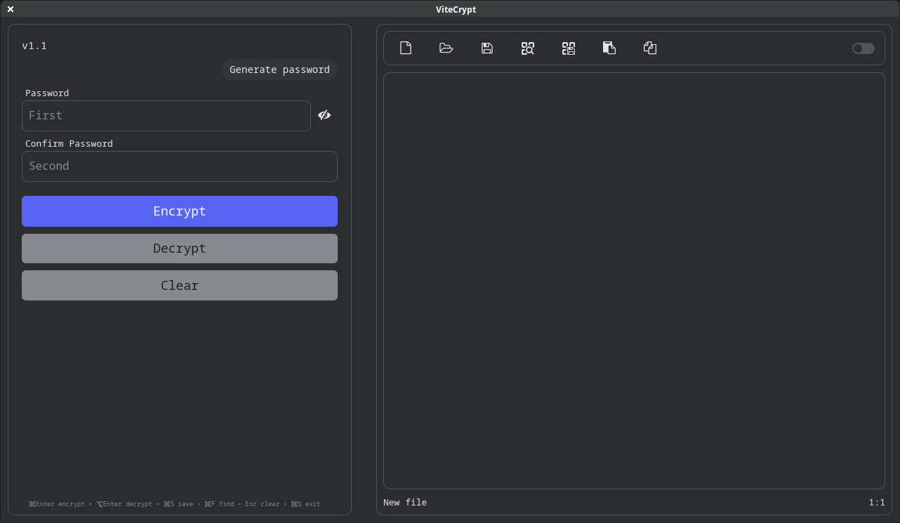

# ViteCrypt

> **Status:** This project was created to experiment with the iced-rs framework
> on Linux. It is not intended for professional or production use, and is not
> recommended for sensitive data.

A local desktop application for encrypting text, saving it as a PNG QR code,
and decrypting text from QR codes. Built with 🦀 Rust and 🧊 iced 0.14.0.



## Features

- Encrypt text
- Save encrypted text as a PNG QR code
- Decrypt text from QR codes
- Find and replace text in the editor
- Remove all spaces and line breaks from text
- Open and save text files
- Generate random passwords with a user-defined length and character sets
  (uppercase letters, lowercase letters, numbers, and special characters)
- Generate mnemonic passphrases with a user-defined number of words
- Choose between light and dark themes
- Copy text to and paste text from the clipboard

## Build from source

You need [Rust](https://rust-lang.org/) installed.

Build for your current platform:

```bash
cargo build --release
```

Build for different platforms on your current system:

```bash
# build release cross-compiled Windows executable on linux
sudo apt install mingw-w64 binutils-mingw-w64-x86-64 gcc-mingw-w64-x86-64 # sudo dnf install mingw64-binutils mingw64-gcc
command -v x86_64-w64-mingw32-dlltool
rustup target list
rustup target add x86_64-pc-windows-gnu
cargo build --release --target x86_64-pc-windows-gnu

# build macos but only on a mac because you need their specific linker
rustup target list
rustup target add aarch64-apple-darwin
cargo build --release --target aarch64-apple-darwin
```

## Linux compatibility

Linux release binaries are built on Ubuntu 24.04. They may require glibc 2.39 or newer.

## Clipboard support

Clipboard operations use native operating-system APIs or commonly available command-line utilities:

- **Windows**: PowerShell and `System.Windows.Forms.Clipboard`
- **macOS**: `pbcopy` and `pbpaste`
- **Linux/Wayland**: `wl-copy` and `wl-paste`
- **Linux/X11**: `xclip` or `xsel`

Clipboard access may fail when the required utility is unavailable,
the desktop session is not accessible, or the operating system denies
access to the clipboard.

## Word list

You may use any word list, provided it contains at least 2,000 words, with one word per line. The pre-build check `build.rs` enforces this requirement.

The included word list, `src/wordlist.txt` (`Archive/WordList/de-7776-v1.txt`), is multi-licensed under Unlicense, CC0 and BSD-3.

## Licensing

The original source code in this repository, including prior commits, and binaries built from it are licensed under the MIT License, except for third-party components, which remain subject to their respective licenses. The iced and iced_dialog crates are MIT-licensed.
